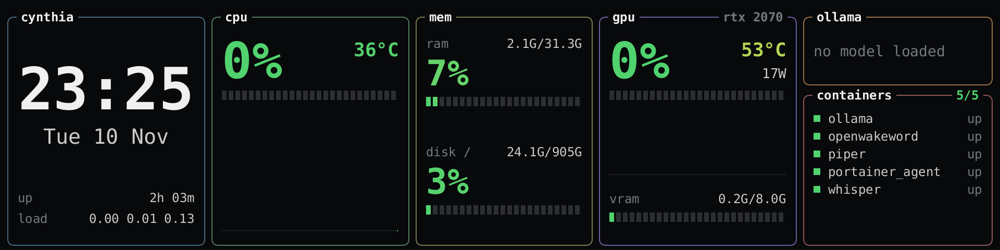

# turzx-stats

A small stats screen for the **TURZX 9.2" USB panel** (`1cbe:0092`, 1920x480) on Linux, in the
look of a terminal monitor. It reads the numbers, draws one picture, sends it, and sleeps until
the next update, so the processor can idle in between.



It shows the time and date, uptime and load, CPU load and temperature with a history, memory,
the root disk, an NVIDIA card (load, temperature, power, VRAM), the model
[Ollama](https://ollama.com) has loaded, and the Docker containers (stopped ones first, in
red). Whatever cannot be read on your machine says so in its box; nothing else breaks.

## Why

The panel has no video input: a program has to draw every picture and push it over USB. The
programs that do this well are built for animation and keep the processor awake. On a Ryzen 7
3800X that was the difference between an idle temperature near 28 °C and one near 50 °C.
Measured on that machine, idle, one picture every 5 seconds:

| | An animated panel app | turzx-stats |
|---|---|---|
| Share of one core | 8-31 % | 0.3 % |
| Wake-ups per second | about 40 | 1.5 |
| Memory (resident) | 100-140 MB | 69 MB |
| CPU temperature | 44-56 °C | 26-44 °C, mostly 26-31 |

## Build

```
cargo build --release
```

A recent Rust toolchain (written with 1.99) and a C compiler (libusb is built in; no `libusb` or `libudev` package is
needed). The binary is about 0.8 MB and links only to libc.

## Run

```
target/release/turzx-stats --png preview.png   # draw to a file; no panel needed
target/release/turzx-stats --once              # one picture on the panel
target/release/turzx-stats                     # keep it up to date
```

| Option | Default | |
|---|---|---|
| `--interval SECONDS` | 5 | time between updates; the clock shows minutes, so 5 to 60 all read well |
| `--brightness 0-100` | 60 | the panel's backlight |
| `--fonts DIR` | `/usr/share/fonts/truetype/dejavu` | a folder with `DejaVuSansMono.ttf` and `DejaVuSansMono-Bold.ttf` (Debian and Ubuntu: `fonts-dejavu-core`) |
| `--once` | | send one picture and leave it |
| `--png FILE` | | write the picture to a file instead |

Close any other program that drives the panel first: it keeps the device to itself.
Stopping turzx-stats (Ctrl+C, SIGTERM) turns the panel dark, so a stopped screen never shows
old numbers.

## Set up

1. **USB permission.** [deploy/61-turzx-plugdev.rules](deploy/61-turzx-plugdev.rules) gives the
   panel to the members of group `plugdev`; the file says how to install it.
2. **A service.** [deploy/turzx-stats.service](deploy/turzx-stats.service) is a systemd user
   service; it expects the binary at `~/apps/turzx-stats/turzx-stats`.
3. **For the last two boxes:** Ollama on `127.0.0.1:11434`, and membership of group `docker`
   for the container list (it reads `/var/run/docker.sock`).

## What it is not

- Not for other panels. Only the 9.2" (`1cbe:0092`) is known to work; the other TURZX USB sizes
  speak the same protocol with other resolutions and would need their size added.
- Not themeable without editing `src/screen.rs`. That file is the whole layout, and it is short.
- No animation and no video mode, on purpose.

## Protocol

From the protocol notes of [Libre Panel](https://github.com/syntensa/libre-panel)
(`docs/protocol/turzx-usb.md`, GPL-3.0), which build on
[turing-smart-screen-python](https://github.com/mathoudebine/turing-smart-screen-python). In
short: 512-byte command packets, DES-CBC with a fixed key, and the picture as an RGBA PNG of
480x1920 following its packet in the same bulk transfer. turzx-stats sends three commands
only: hello (10), brightness (14) and PNG frame (102). It writes nothing to the panel's storage
or firmware.

## Licence

GPL-3.0-or-later, see [LICENSE](LICENSE).
